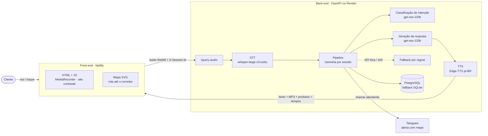

# Totem de Autoatendimento Acessível

Totem de loja que atende o cliente **por voz**: entende o pedido em português, busca o produto no estoque, responde falando e desenha no mapa da loja a rota até o corredor. Pensado para pessoas com deficiência visual ou com dificuldade de usar telas de autoatendimento.

**[▶ Demo ao vivo](https://totem-acessiveltcc.netlify.app)** · [Documento do TCC](docs/tcc/documento_tcc_totem.md) · [Bateria de avaliação](backend/avaliacao/)


> A demo usa o plano gratuito do Render: a primeira requisição depois de um tempo parado pode levar alguns segundos a mais, enquanto o servidor acorda. Use Chrome, Edge ou Firefox (o Safari não grava áudio em WebM).

---

## Resultados

Medidos com o back-end publicado no Render. Scripts e dados brutos em [`backend/avaliacao/`](backend/avaliacao/).

| Métrica | Resultado | Como foi medido |
|---|---|---|
| Acurácia do classificador de intenções | **97,3 %** (73/75) | 75 frases coloquiais, 15 por intenção |
| WER da transcrição | **7,59 %** | 60 áudios, duas vozes; 80 % das frases sem nenhum erro |
| Latência ponta a ponta, p50 | **1,99 s** | interações que consultam o LLM (n = 41), medida no cliente |
| Latência ponta a ponta, p95 | **5,53 s** | idem |
| Respostas perdidas por erro da API | **0 de 60** | confirmado nos logs do servidor |

Latência por etapa (p50, interações com LLM): STT 0,29 s · IA 0,74 s · TTS 0,47 s.

<details>
<summary>Acurácia por intenção</summary>

| Intenção | Acertos |
|---|---|
| Nova busca | 14/15 |
| Pergunta sobre produto | 14/15 |
| Pedido de mapa | 15/15 |
| Encerramento | 15/15 |
| Fora do escopo | 15/15 |

Os dois erros foram casos de fronteira: "tem sandália preta tamanho 37?" (lida como pergunta sobre produto) e "qual é a diferença entre as duas?" sem contexto anterior.
</details>

**Limites honestos da avaliação:** os áudios são sintéticos (sem ruído, sotaque ou hesitação), então o WER é uma estimativa otimista; e no plano gratuito da Groq (8.000 tokens/min) conversas muito rápidas caem no fallback por regras.

---

## Arquitetura



**Fluxo de uma pergunta:** o front grava a fala → o back-end transcreve (STT) → o LLM classifica a intenção (`NOVA_BUSCA`, `SOBRE_PRODUTO`, `IR_PARA_MAPA`, `ENCERRAR`, `OUTROS`) e extrai palavras-chave normalizadas → o produto é buscado no banco → o LLM monta a resposta usando só os dados do estoque → o TTS gera o áudio → o front fala a resposta e, se pedido, desenha a rota no mapa.

### Decisões de engenharia

- **Resiliência sem dependência única.** Se a API do LLM falhar ou bater no limite (HTTP 429), o pipeline segue com regras locais e respostas montadas a partir do banco. Se o PostgreSQL cair, o serviço recorre ao SQLite com a carga inicial. O totem nunca fica mudo.
- **Regras antes do modelo quando faz sentido.** Despedidas, perguntas de pagamento e "onde fica X" com o produto na própria frase são resolvidas sem chamar o LLM: 19 de 60 interações, com p50 de 1,06 s.
- **LLM determinístico e ancorado no estoque.** Temperatura 0, saída em JSON para a classificação e o catálogo da sessão injetado no prompt, para o modelo não inventar produtos.
- **Modelo configurável.** O Llama 3.3 70B foi descontinuado pela Groq no meio do projeto e o totem passou a operar só no fallback sem ninguém perceber. Depois da troca para o gpt-oss-120b, o modelo virou variável de ambiente (`GROQ_LLM_MODEL`) e cada resposta registra se veio do LLM ou das regras.
- **Memória conversacional por sessão.** Histórico de turnos, produtos citados e escolhidos ficam em RAM, isolados por `X-Session-Id`, expiram em 30 min e são limitados a 200 sessões.
- **Privacidade.** O áudio do cliente é apagado logo após o processamento (inclusive em erro); os MP3 gerados expiram em 10 min; nenhuma conversa vai para disco.
- **Segurança.** Nenhum segredo no código; painel administrativo exige `X-Admin-Key` comparada em tempo constante e fica desligado sem a variável; CORS restrito ao domínio publicado; `/health` não expõe integrações nem erros.

---

## Funcionalidades

- Conversa por voz ou texto em português, com memória dos produtos já discutidos
- Rota indoor animada no mapa SVG da loja, com vários produtos, provadores e caixas
- Alto contraste, modo claro/escuro, pausa de sessão e encerramento por inatividade
- Galeria de fotos com zoom (lightbox)
- Botão "chamar atendente": envia ao Telegram da equipe os produtos escolhidos e o mapa
- Painel administrativo para cadastrar e editar o estoque

## Stack

| Camada | Tecnologia |
|---|---|
| Front-end | HTML5, CSS, JavaScript puro, SVG, MediaRecorder API |
| Back-end | Python 3.10, FastAPI, Uvicorn, Docker |
| IA | Groq: `whisper-large-v3-turbo` (STT), `openai/gpt-oss-120b` (intenção e resposta); Edge-TTS (voz) |
| Dados | PostgreSQL (produção), SQLite (desenvolvimento e contingência) |
| Infra | Netlify (front), Render (API e banco) |
| Qualidade | pytest (74 testes), bateria de avaliação com métricas de acurácia, WER e latência |

## Rodando localmente

```bash
cd backend
pip install -r requirements.txt
export GROQ_API_KEY=...        # obrigatório para STT e LLM
export ADMIN_KEY=...           # opcional: habilita o painel administrativo
uvicorn main:app --reload
```

Sem `DATABASE_URL`, o back-end usa `database/produtos.db` (SQLite). Abra `frontend/index.html` no navegador.

Testes e avaliação:

```bash
cd backend
pytest
python avaliacao/avaliar_intencoes.py
python avaliacao/avaliar_voz.py
```

## Estrutura

```text
backend/
  routes/       # /query-audio, /query-text, produtos, admin, atendente
  services/     # pipeline, LLM, STT, TTS, banco, Telegram
  avaliacao/    # frases, áudios sintéticos, scripts de métricas e resultados
  tests/        # suíte pytest
database/       # SQLite de carga inicial e script de seed
frontend/       # interface do totem
docs/           # TCC, PRDs, diagramas, atas
```

---

## Autoria

Trabalho de Conclusão de Curso em Engenharia da Computação, Universidade Santa Cecília (2026). Orientador: Prof. Sergio Schina de Andrade.

- **Rafael Luiz Forssell Ferrara Fomin** ([@rafaelforssell](https://github.com/rafaelforssell)): autor de 98 dos 151 commits. Pipeline conversacional e memória de sessão, integração com o LLM e fallbacks, busca de produtos, mapa e rotas, painel administrativo, integração com Telegram, segurança do back-end e a bateria de avaliação com as métricas acima.
- Davi Xavier de Lima ([@xavierdavo](https://github.com/xavierdavo)): repositório original, PRDs, documentação do TCC, atas e assets.
- Kauã Santos Silva

Repositório original: [xavierdavo/tcc-totem-acessivel](https://github.com/xavierdavo/tcc-totem-acessivel).
